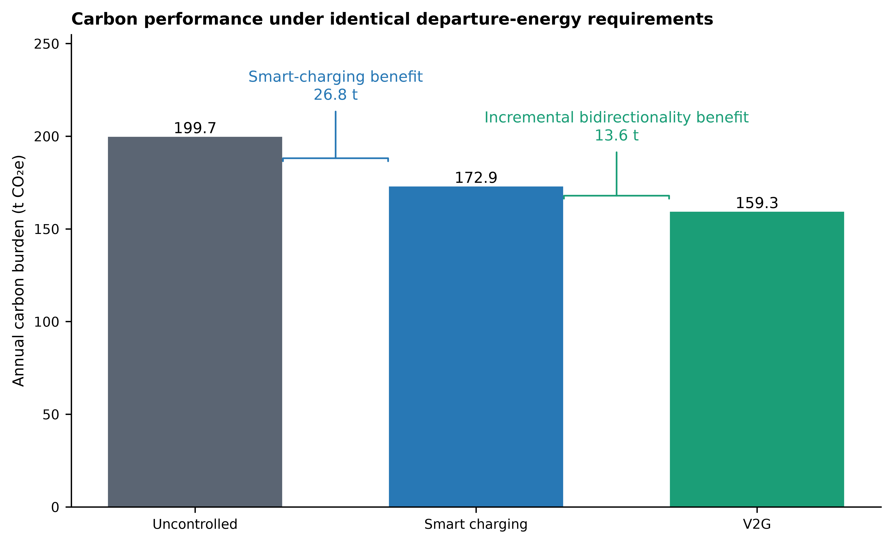
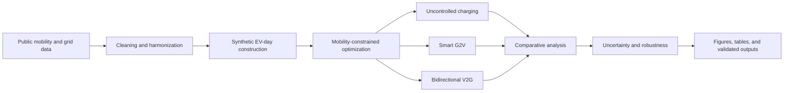
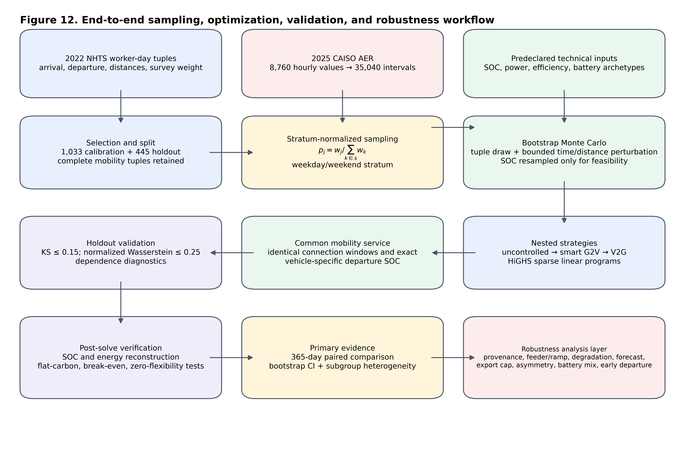

<div align="center">

# Mobility-Constrained Carbon-Aware G2V and V2G Scheduling

### Quantifying the incremental value of bidirectionality for energy-efficient electric mobility

[](https://www.python.org/)
[](https://highs.dev/)


A complete, reproducible research repository for evaluating uncontrolled charging,
carbon-aware smart charging, and mobility-constrained vehicle-to-grid scheduling.

[Key findings](#key-findings) · [Reproduce](#reproduce-the-study) · [Repository map](#repository-map) · [Research outputs](#research-outputs)

</div>



## Research overview

Electric vehicles can be flexible grid assets, but the climate value of flexibility depends on when vehicles are connected, how much energy drivers require, the carbon intensity of electricity, charging infrastructure, and battery wear. This project evaluates three strategies under a common mobility-constrained framework:

1. **Uncontrolled charging (UC):** charge immediately after connection.
2. **Carbon-aware smart charging (G2V):** shift charging toward lower-carbon intervals.
3. **Carbon-aware V2G:** add bidirectional discharge while preserving mobility and operational constraints.

The central estimand is deliberately incremental:

```text
Value of smart charging = UC emissions − smart-charging emissions
Incremental value of V2G = smart-charging emissions − V2G emissions
```

This separation prevents the benefits of basic temporal load shifting from being incorrectly attributed to bidirectionality.

## Key findings

| Comparison | Annual avoided emissions | Relative reduction |
|---|---:|---:|
| Smart charging vs. uncontrolled charging | 26.80 tCO₂ | 13.42% |
| V2G vs. smart charging | 13.63 tCO₂ | 7.88% |
| V2G vs. uncontrolled charging | 40.43 tCO₂ | 20.25% |

- The 95% bootstrap confidence interval for the incremental V2G reduction is reported with the primary results.
- A 600 kW site constraint remains non-binding in the base case, while tighter limits expose infrastructure sensitivity.
- Private owner economics are modest in the base case and depend strongly on compensation and battery-wear assumptions.
- Benefits are concentrated in a subset of connected vehicles and time periods rather than distributed uniformly.
- Forecast-error, participation, degradation, infrastructure, and fleet-composition analyses test the robustness of the central result.

> **Interpretation boundary:** the analysis uses average emissions rate (AER) signals and therefore estimates accounting-based carbon outcomes, not causal marginal system emissions.

## Study workflow





## Reproduce the study

### Option A — Conda

```bash
conda env create -f environment.yml
conda activate v2g-carbon
```

### Option B — Python virtual environment

```bash
python3.12 -m venv .venv
source .venv/bin/activate
python -m pip install --upgrade pip
python -m pip install -r requirements.txt
```

### Run the analysis

For a fast end-to-end check:

```bash
python scripts/run_all.py --quick
```

For the complete primary workflow:

```bash
python scripts/run_all.py
```

For the extended robustness analyses:

```bash
python -m src.analysis.robustness_sensitivity
python -m src.analysis.robustness_tables
python -m src.visualization.fig12_robustness_extensions
```

Verify the repository after a run:

```bash
python -m pytest -q
python -m src.validation.final_quality_control
```

See the [reproducibility guide](docs/REPRODUCIBILITY.md) for complete execution and interpretation notes.

## Repository map

```text
.
├── config/                  Experiment and model configuration
├── data/
│   ├── raw/                 Archived source inputs
│   ├── processed/           Harmonized analysis-ready inputs
│   └── synthetic/           Seeded EV-day populations
├── docs/                    Reproducibility and data/result documentation
├── results/
│   ├── figures/             14 figures in PNG, PDF, and SVG
│   ├── tables/              Main and supplementary result tables
│   ├── sensitivity/         Parameter sensitivity outputs
│   ├── robustness/          Extended robustness experiments
│   └── validation/          Machine-readable quality-control evidence
├── scripts/                 Reproduction entry points
├── src/                     Data, optimization, analysis, visualization, and QC code
└── tests/                   Automated regression and consistency tests
```

For a field-level description of major inputs and outputs, see the [data and results guide](docs/DATA_AND_RESULTS.md).

## Research outputs

- [Headline results](results/results_summary.md)
- [Final quality-control report](results/validation/final_quality_control.csv)
- [Publication-quality figures](results/figures/)
- [Publication-quality tables](results/tables/)
- [Extended robustness results](results/robustness/)

## Validation and reproducibility

The repository includes automated checks for model consistency, result integrity, and figure/table completeness. The verified release state is:

- **Unit and regression tests:** 5 passed
- **Final quality-control checks:** 15/15 passed
- **Research figures:** 14, each available in PNG, PDF, and SVG
- **Configuration seed:** `20260821`

Large generated outputs are retained so that readers can inspect reported results without rerunning the year-long simulation. Deterministic seeds and configuration files support regeneration.

## Data sources and scientific scope

The workflow integrates public mobility and electricity-system data with transparent synthetic-population construction. Source archives are preserved under `data/raw/`; provenance and transformations are summarized in the [data and results guide](docs/DATA_AND_RESULTS.md).

The model is intended for scenario analysis and comparative evaluation. It does not claim real-time dispatch feasibility, distribution-network power-flow validation, causal marginal emissions, or a universal owner-business case. These boundaries motivate future research.

## Citation

Please cite the research software using the metadata in [CITATION.cff](CITATION.cff). Repository version history is documented in [CHANGELOG.md](CHANGELOG.md).

## Repository policy

This is a private research repository. Access does not grant permission to redistribute derived datasets or project outputs. See [LICENSE.md](LICENSE.md) and [CONTRIBUTING.md](CONTRIBUTING.md).

<div align="center">

**Reproducible analysis · transparent assumptions · decision-relevant carbon accounting**

</div>
